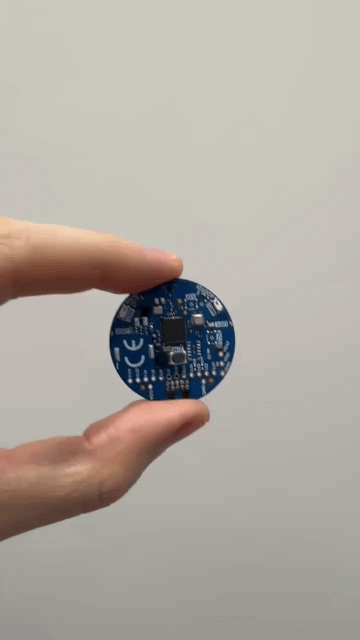

.. _app_model_observability:

Model observability
###################

.. contents::
   :local:
   :depth: 2

This application demonstrates how to observe an nRF Edge AI model running on a device and send its runtime statistics to the cloud using Memfault.

Application overview
********************

The application recognizes motion activities from accelerometer data using an nRF Edge AI model, and collects observability metrics of the model output using the :ref:`nrf_edgeai_obsv_lib`.
It is a reference for adding model observability to your own application.
For a conceptual introduction to model observability, see :ref:`model_observability`.

The model runs on the CPU and recognizes four activity classes:

* Idle
* Updown
* Circle
* Flip

The application reads the BMI270 accelerometer at 100 Hz and feeds the magnitude of the acceleration vector to the model.
The model uses a window of 200 samples (2 seconds) and runs inference every 50 samples (0.5 second).
The neural network model is trained using the `Nordic Edge AI Lab`_.

The application supports two Bluetooth® Low Energy services, selected with the ``CONFIG_APP_BLE_MDS`` Kconfig option:

* Memfault Diagnostic Service (MDS) - The application collects observability metrics of the model output.
  A gateway forwards the collected metrics to `Memfault`_.
  The recognized class is only shown on the LED and in the log.
* Nordic UART Service (NUS) - The application sends the recognized class and its probability to a connected peer after each inference.
  Observability is not initialized in this mode.

Observability
=============

The application collects the following output metrics from the class-probability vector produced by the model after each inference:

* :ref:`Class predictions distribution <nrf_edgeai_obsv_metrics_built_in_class_pred>` - How often each class is predicted and with what probability, including how long the same class is predicted in a row.
* :ref:`Transition matrix <nrf_edgeai_obsv_metrics_built_in_transition>` - How often the predicted class changes from one class to another.
* :ref:`Model certainty descriptor <nrf_edgeai_obsv_metrics_built_in_certainty>` - How confident the model is in its predictions.

The observability code is located in the :file:`src/model_obsv.c` file.
It creates the observability context, sizes and registers the metrics for the number of classes of the model, and binds the Memfault transport.
The :file:`src/main.c` file only passes the class probabilities of each inference to it.
Use these files as a starting point for observing your own model.

The metrics are collected automatically at an interval set by the ``CONFIG_NRF_EDGEAI_OBSV_MEMFAULT_AUTO_COLLECT_INTERVAL_SEC`` Kconfig option.
After each collection, the metrics are encoded and staged as a `Memfault Custom Data Recording <Memfault Custom Data Recording_>`_ (CDR).
A gateway, for example a phone, reads the staged recording over MDS and uploads it to `Memfault`_.
The metrics are reset after each collection, so every recording describes one collection period.

.. note::
   A new collection is skipped while the previous recording is still waiting to be read by the gateway.
   The metrics of the current period are then kept and sent with the next recording.

Requirements
************

The application supports the following development kits:

.. table-from-sample-yaml::

Development kits
================

The :doc:`nRF54L15TAG <zephyr:boards/nordic/nrf54l15tag/doc/index>` is a development board for the nRF54L15 SoC.
It has a BMI270 sensor and an RGB LED.

.. list-table::
   :header-rows: 0

   * - .. figure:: ../gesture_recognition/images/nrf54l15tag_top.jpeg
          :alt: nRF54L15 TAG top view

     - .. figure:: ../gesture_recognition/images/nrf54l15tag_bottom.jpeg
          :alt: nRF54L15 TAG bottom view

Sensor BMI270
=============

The `Bosch BMI270`_ is a 3-axis accelerometer and 3-axis gyroscope IMU sensor.
The application uses only the accelerometer with a full scale of 4 g.
The sensor settings and the sample conversion match the :ref:`data_forwarder_sample` sample, so the model sees the same data on the device as during training.

Setting up software environment
*******************************

For full instructions on preparing your development environment, see :ref:`setting_up_environment`.

User interface
**************

This section describes the user interface available on development kits in this application.

LEDs
====

The RGB LED shows the Bluetooth LE connection state and the activity recognized by the model.

The blinking rate indicates the Bluetooth LE connection state:

* Fast blinking (3 Hz) - The device is advertising and waits for a Bluetooth LE connection.
* Slow blinking (1 Hz) - A peer is connected.

The color indicates the recognized activity:

.. list-table:: LED color for recognized activities
   :header-rows: 1
   :widths: 30 70

   * - Activity
     - LED color
   * - Idle (default)
     - Blue
   * - Updown
     - Red
   * - Circle
     - Green
   * - Flip
     - Red and green

The color changes only after the same activity is recognized three times in a row.
One recognition of a different class inside such a series is ignored, so a single misclassified inference does not make the LED flicker.
The application prints the new activity to the log each time the color changes.

Configuration
*************

|config|

Replacing the model
===================

The :file:`nrf_edgeai_generated/` directory contains the model files exported from the `Nordic Edge AI Lab`_.
These files are committed to the repository so that the application builds without access to the Lab.

The directory contains the following files:

* :file:`nrf_edgeai_user_model.c` and :file:`nrf_edgeai_user_model.h` - Generated model definition and its API.
* :file:`nrf_edgeai_user_model_labels.h` - Class labels of the model, used by the application to select the LED color.
* :file:`nrf_edgeai_user_types.h` - Generated type definitions used by the model.
* :file:`prj_example.conf` - Kconfig fragment showing the options required by the exported model.

To use your own model, complete the following steps:

1. Export the model from the `Nordic Edge AI Lab`_.
   The model must take one ``float32`` input, the magnitude of the acceleration vector in meters per second squared, which is checked when the application starts.
#. Replace the contents of the :file:`nrf_edgeai_generated/` directory with the exported output.
   Delete the previously generated files first, so that no files from the previous model are left behind.
#. Update the class labels in the :file:`nrf_edgeai_user_model_labels.h` file and the color mapping in the :file:`src/ux_state_manager.c` file.
#. If the number of classes changes, set the ``CONFIG_NRF_EDGEAI_OBSV_MAX_CLASSES`` Kconfig option to the new number of classes.

Choosing the Bluetooth LE service
=================================

Select the Bluetooth LE service with the ``CONFIG_APP_BLE_MDS`` Kconfig option:

* ``CONFIG_APP_BLE_MDS=y`` - Observability metrics are collected and exposed over MDS.
  This option requires the :file:`observability.conf` configuration file.
* ``CONFIG_APP_BLE_MDS=n`` - The recognized class is sent over NUS as a text line in the ``<class>,<probability>`` format, where the class is the index of the class and the probability is given in percent.
  Observability is not initialized in this mode.

Configuration files
===================

The application provides the :file:`observability.conf` configuration file for enabling observability.

This file enables the observability library with the Memfault transport and the following metrics:

* Class predictions distribution (``CONFIG_NRF_EDGEAI_OBSV_METRIC_CLASS_PRED_DIST``)
* Transition matrix (``CONFIG_NRF_EDGEAI_OBSV_METRIC_TRANSITION_MATRIX``)
* Model certainty descriptor (``CONFIG_NRF_EDGEAI_OBSV_METRIC_MODEL_CERTAINTY_DESC``)

The file also enables Memfault with automatic metrics collection and Bluetooth LE bonding.
It sets the memory sizing for the model: ``CONFIG_NRF_EDGEAI_OBSV_MAX_CLASSES``, ``CONFIG_NRF_EDGEAI_OBSV_MEMFAULT_MAX_CONTEXTS`` and ``CONFIG_SYSTEM_WORKQUEUE_STACK_SIZE``.
The workqueue stack must be large enough to hold the encode buffer used by the automatic collection.

Check :ref:`nrf:cmake_options` and use the :makevar:`EXTRA_CONF_FILE` variable to include this configuration file.

.. note::
   Set the ``CONFIG_MEMFAULT_NCS_PROJECT_KEY`` Kconfig option to your `Memfault`_ project key to successfully send metrics to Memfault.

Additional configuration
========================

Check and configure the following library options that are used by the application:

* ``CONFIG_MEMFAULT_NCS_PROJECT_KEY`` - A key to your `Memfault`_ project.
* ``CONFIG_NRF_EDGEAI_OBSV_MAX_CLASSES`` - Number of classes the observed model predicts.
* ``CONFIG_NRF_EDGEAI_OBSV_MEMFAULT_AUTO_COLLECT_INTERVAL_SEC`` - Interval of automatic metrics collection.
  For testing, use a shorter interval and enable server debug mode for the device in the `Memfault`_ dashboard.
* ``CONFIG_NRF_EDGEAI_OBSV_CLASS_PRED_DIST_BIN_NUM`` and ``CONFIG_NRF_EDGEAI_OBSV_MODEL_CERTAINTY_DESC_BIN_NUM`` - Number of histogram bins of the metrics.

For the full list of the library options, see :ref:`nrf_edgeai_obsv_buffer_config`.

Configuration options
=====================

.. options-from-kconfig::
   :show-type:

Building and running
********************

.. |application path| replace:: :file:`applications/model_observability`

.. include:: /includes/application_build_and_run.txt

Testing
=======

|test_application|

1. |connect_kit|
#. |connect_terminal_kit|
   Connect to the serial device printing console output.
#. Observe that the LED blinks blue at 3 Hz.
   The device is advertising and recognizes the idle activity.
#. Move the device as described in :ref:`model_observability_activities`.
   Observe that the LED color changes and that the terminal displays messages similar to the following:

   .. code-block:: console

      Activity -> circle
      Activity -> idle
      Activity -> updown
      Activity -> flip

If you have enabled the model observability, also complete the following steps:

#. Check that the terminal shows a message similar to the following when the application starts:

   .. code-block:: console

      Observability initialized: model id 97286, 4 classes

#. Connect a gateway to your device.
   Ready-to-use gateways are `nRF Connect Device Manager`_ or `Memfault WebBluetooth Client`_.
   Check the Testing section of :ref:`nrf:peripheral_mds` for details.
   After the connection, the LED blinks at 1 Hz.
#. Perform the activities for the duration set by the ``CONFIG_NRF_EDGEAI_OBSV_MEMFAULT_AUTO_COLLECT_INTERVAL_SEC`` Kconfig option.
#. In a web browser, navigate to `Memfault`_.
#. In the left-hand menu, go to :guilabel:`CDR Payloads`.
#. Select a CDR payload from your test device with "edgeai_observability" as reason.
   You can filter the list of CDR payloads by device name and time.
#. Download the payload for metrics analysis.
#. Decode it on a host PC using the :file:`scripts/decode_edgeai_obsv_cdr/decode_edgeai_obsv_cdr.py` script in binary mode:

   .. code-block:: shell

      ./scripts/decode_edgeai_obsv_cdr/decode_edgeai_obsv_cdr.py --binary --file <downloaded>.bin

   See :ref:`nrf_edgeai_obsv_script` for installation and other input modes.
   The payload format is defined in the :file:`lib/nrf_edgeai_obsv/obsv.cddl` file.

#. Compare the decoded metrics with the activities you performed.
   For example, the class predictions distribution shows how often each activity was recognized, and the transition matrix shows how the predicted class changed between the activities.

.. _model_observability_activities:

Activities
**********

This section shows the correct device orientation and motion for performing the supported activities.
The model was trained with a limited dataset.
For optimal recognition across different users, follow the instructions carefully and train a new model with a larger dataset.

Make sure that the default (initial) position of the device matches the following:

The activities are performed with the device in the initial position.
Keep in mind the device orientation, as it is important for the recognition to work correctly.

.. list-table:: Activities
   :header-rows: 1

   * - Updown
     - Circle
     - Flip
   * - .. figure:: images/activity_updown_nrf54l15tag.gif
          :alt: Updown
     - .. figure:: images/activity_circle_nrf54l15tag.gif
          :alt: Circle
     - .. figure:: images/activity_flip_nrf54l15tag.gif
          :alt: Flip

Dependencies
************

This application uses the following |EAI| libraries:

* :ref:`nrf_edgeai_lib`
* :ref:`nrf_edgeai_obsv_lib`

This application uses the following |NCS| services:

* :ref:`nrf:nus_service_readme`
* :ref:`nrf:peripheral_mds`

This application uses the following Zephyr libraries:

* :ref:`zephyr:logging_api`
* :ref:`zephyr:sensor`
